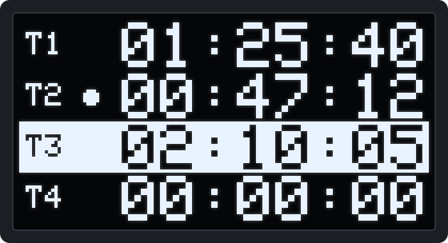
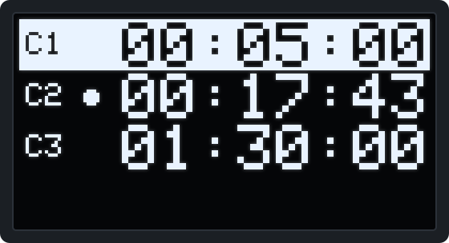
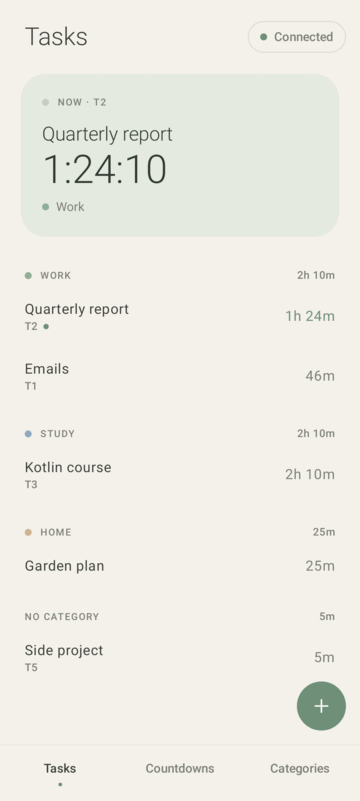
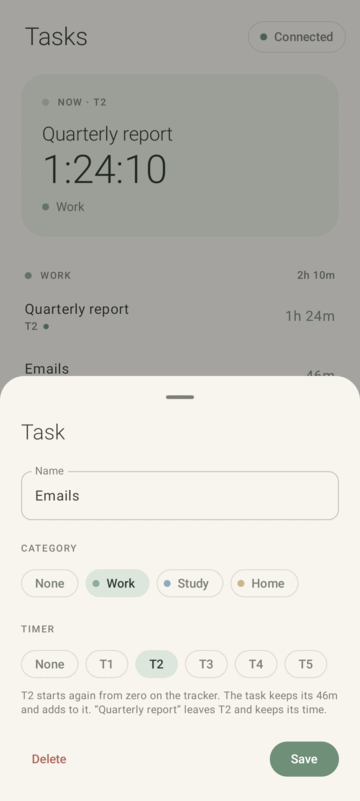
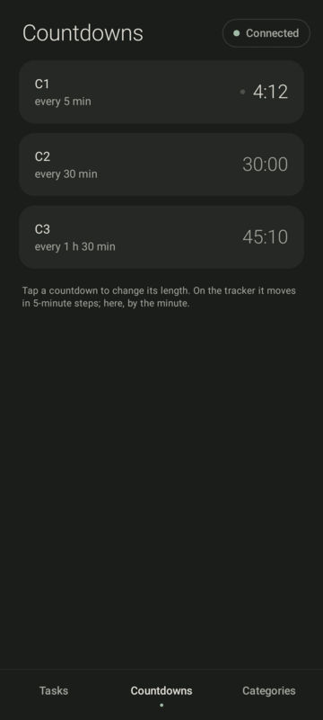

# ESP32-C3 TimeTracker

A small desk gadget for focused work: **five task time trackers** and **three recurring reminder timers** on a 1.3″ OLED, run with three buttons and a buzzer. An optional **Android app** connects over Bluetooth and adds up the time per task and category.


<p align="center">
  
  &nbsp;
  
</p>
<p align="center"><sub>Pixel-accurate renders of the two screens. The inverted row is the selection; a dot marks a running timer.</sub></p>

## The idea

**Trackers tab: what am I working on right now?** Five stopwatches, T1–T5, one per task. Only one runs at a time: starting a task stops the previous one, so the totals add up to what you actually did. There are deliberately only five, since juggling more tasks than that at once is a bad idea (honestly, even five is a lot).

**Countdowns tab: reminders through the day.** Three countdowns, C1–C3, preset to 5 min, 30 min and 1 h 30 min and adjustable in 5-minute steps. When one reaches zero the buzzer beeps three times and the countdown starts over, so it works as a recurring reminder. Stop it by hand and it doubles as an ordinary one-shot timer.

Everything is saved to flash, so trackers and countdowns pick up where they left off after a power cycle.

## The phone app

The Android app in [`android/`](android) gives names to what the trackers measure. Create tasks in the app, sort them into categories, and give each task one of the trackers, T1–T5. The app then adds that tracker's time to the task. The tracker itself knows nothing about tasks: it keeps working on its own exactly as before.

<p align="center">
  
  &nbsp;
  
  &nbsp;
  
</p>

- **Giving a task a tracker** resets that tracker to 00:00:00 on the device. This applies to a task's first tracker and to moving it to another one. In the app the task keeps its time and keeps adding to it. Time a tracker counted before the link never ends up in a task, so switching trackers can't pad a task's time.
- **Nothing is lost while the phone is away.** Besides the time on the display, each tracker keeps a total that no button resets. Whenever the app connects, it picks up everything counted since the last connection. A long OK press clears only the display; the task keeps its time.
- **Countdowns** can be set from the app to the minute, from 1 minute to 24 hours. On the device they still move in 5-minute steps.

The app is written in Kotlin with Jetpack Compose and needs Android 8.0 or newer. To build and install it on Arch Linux, see [android/BUILD.md](android/BUILD.md). The Bluetooth protocol is documented in [docs/ble-protocol.md](docs/ble-protocol.md).

## Controls

| Button | Short press | Long press (~1 s) |
|---|---|---|
| **▲ UP** | Select the row above | Countdowns: **+5 min** (up to 24 h) |
| **▼ DOWN** | Select the row below | Countdowns: **−5 min** (down to 1 min) |
| **OK** | Start / stop the selected timer | Trackers: reset to 00:00:00<br>Countdowns: restore the preset and stop |

**Switch tabs** by holding **▲ + ▼** together for about a second.

A long press is recognized when you release the button. Every action is confirmed with a short beep, and the selection wraps around at the ends of the list.

## Hardware

| Part | Notes |
|---|---|
| ESP32-C3 board | Any ESP32-C3 dev board, e.g. a SuperMini |
| 1.3″ OLED, 128×64, SH1106, I²C | Address `0x3C` |
| 3 × tactile push button | Wired to GND; the internal pull-ups are used, no resistors needed |
| Passive buzzer | One *without* a built-in oscillator; the firmware generates the tone with PWM |
| Small NPN transistor + ~1 kΩ resistor | Drives the buzzer louder than a GPIO pin can on its own |

### Wiring

| ESP32-C3 | Connects to |
|---|---|
| 3V3 | OLED `VDD` |
| GND | OLED `GND`, one leg of each button, transistor emitter |
| GPIO6 | OLED `SDA` |
| GPIO7 | OLED `SCK` (I²C clock) |
| GPIO2 | OK button |
| GPIO4 | ▲ UP button (`BACK` in the code) |
| GPIO3 | ▼ DOWN button (`NEXT` in the code) |
| GPIO5 | Transistor base, through the resistor |

Buzzer driver, a plain low-side switch:

```
            3V3 (or 5V)
                │
            [ buzzer ]
                │
                C
GPIO5 ──[1kΩ]── B    NPN: S8050, 2N2222, BC547, …
                E
                │
               GND
```

If your buzzer is the electromagnetic (coil) kind rather than piezo, put a small diode such as a 1N4148 across it, with the cathode on the + side. All pins are defined at the top of the sketch if you want to move things around.

## Building and flashing

You need the **ESP32 Arduino core 3.x** (the sketch uses the 3.x `ledcAttach()` API) and three libraries: **Adafruit SH110X**, **Adafruit GFX Library** and **NimBLE-Arduino** 2.x (Bluetooth).

**Arduino IDE:** install *esp32 by Espressif Systems* in Boards Manager and the three libraries in Library Manager (accept the Adafruit BusIO dependency when asked). Open `timetracker_cgpt.ino`, select **ESP32C3 Dev Module** and upload.

**arduino-cli:**

```sh
URL=https://espressif.github.io/arduino-esp32/package_esp32_index.json
arduino-cli core update-index --additional-urls $URL
arduino-cli core install esp32:esp32 --additional-urls $URL
arduino-cli lib install "Adafruit SH110X" "Adafruit GFX Library" "NimBLE-Arduino"

arduino-cli compile --fqbn esp32:esp32:esp32c3 .
arduino-cli upload  --fqbn esp32:esp32:esp32c3 -p /dev/ttyACM0 .
```

> [!NOTE]
> Arduino requires the sketch folder to have the same name as the `.ino` file. If you clone this repository under a different name, rename the folder to `timetracker_cgpt`.

## Configuration

These constants are at the top of `timetracker_cgpt.ino`:

| Constant | Default | Meaning |
|---|---|---|
| `PIN_*` | see [Wiring](#wiring) | GPIO assignments |
| `MAX_TRACKERS` | `5` | Number of trackers |
| `MAX_COUNTDOWNS` | `3` | Number of countdowns |
| `LONG_MS` | `1000` | Long-press threshold, ms |
| `TAB_SWITCH_MS` | `800` | How long to hold ▲ + ▼ to switch tabs, ms |
| `AUTOSAVE_MS` | `60000` | How often state is written to flash, ms |

The countdown presets (5, 30 and 90 minutes) are set in `loadAll()`.

## Saved state

Tracker times and totals, the running tracker, each countdown's duration, remaining time and run state, the current tab and the selections are written to the ESP32's NVS flash every 60 seconds and restored at boot. As a result:

- Up to a minute of progress can be lost when the power goes off.
- There is no real-time clock, so time doesn't advance while the device is off. A running tracker carries on from its last saved value.

To wipe everything, uncomment the `prefs.clear()` block at the start of `setup()`, flash once, then comment it out again and flash again. This also gives the tracker a new random id. The app notices the new id and carries on from the wiped trackers' new totals, adding nothing to any task.

## Troubleshooting

- **Blank screen and a low beep repeating twice a second:** the display didn't answer at I²C address `0x3C`. Check the SDA/SCL wiring, or try `0x3D` in `display.begin()`.
- **Garbled or shifted image:** your module may have an SSD1306 controller instead of an SH1106 (they look the same). Switch the sketch to the Adafruit SSD1306 library: `Adafruit_SSD1306 display(...)`, `display.begin(SSD1306_SWITCHCAPVCC, 0x3C)` and `SSD1306_WHITE` / `SSD1306_BLACK`.
- **`'ledcAttach' was not declared in this scope`:** your ESP32 core is 2.x; update it to 3.x.

## Project layout

```
timetracker_cgpt.ino   firmware: buttons, timers, drawing, NVS persistence, Bluetooth
android/               the Android app (Kotlin, Jetpack Compose); BUILD.md explains the build
docs/ble-protocol.md   how the firmware and the app talk over Bluetooth
docs/*.svg, docs/*.png images used in this README
```
